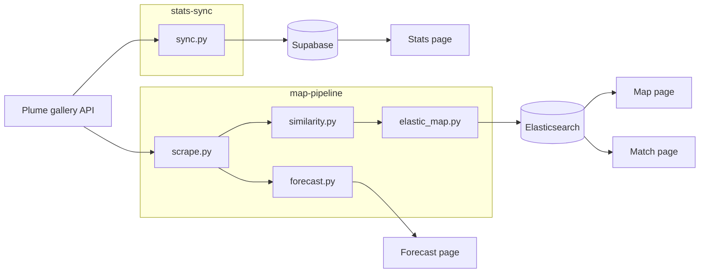
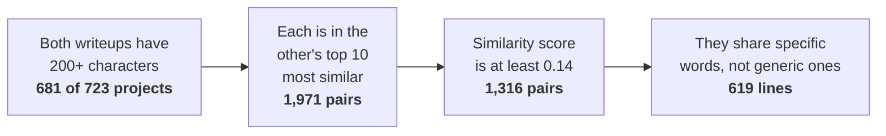
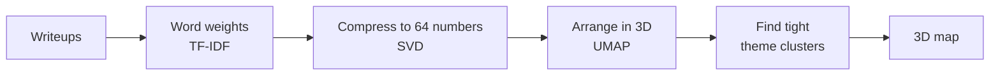
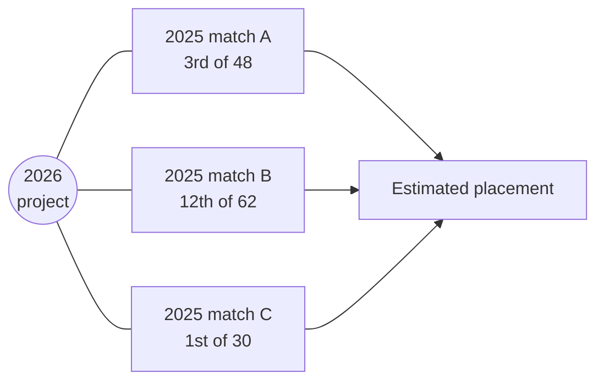

<h1 align="center">HackMIT 2026 Project Explorer</h1>

<p align="center">
  Live stats, a 3D map of project ideas, and a ranking forecast for HackMIT 2026,
  built from the public project gallery.
</p>

<p align="center">
  <a href="https://hackmit2026.com">Live site</a> ·
  <a href="#how-it-works">How it works</a> ·
  <a href="#results">Results</a> ·
  <a href="./docs">Docs</a>
</p>

---

## Overview

HackMIT posts every project to a public gallery on [Plume](https://plume.hackmit.org),
the platform it uses for submissions and judging. The gallery lets you browse
projects one at a time, but it doesn't show the bigger picture: who is
competing, what people are building, which ideas are similar, or how projects
might place.

This project pulls that public data and turns it into four tools:

| Page | What it does |
|---|---|
| **Stats** | Live numbers on projects, schools, team sizes, sponsor challenges, tech used and judging results, with a comparison to 2025. |
| **Map** | A 3D map of 723 HackMIT and Blueprint projects from 2025–2026. Similar projects sit close together, and a line connects two projects only when their writeups clearly describe the same kind of thing. |
| **Forecast** | Ranks 2026 projects by comparing each one to the most similar judged projects from 2025. |
| **Match** | Paste in a project description and see the most similar judged 2025 projects and how they placed. |

## How it works



There are two separate pipelines, both reading the same public API:

- **`stats-sync`** copies every project and its team into a Supabase database.
  The stats page reads from there, and the sync can rerun every 10 minutes during
  judging so rankings show up live.
- **`map-pipeline`** saves every project to a local JSON file, then builds the
  similarity map and the forecast from it. The map is uploaded to Elasticsearch,
  which also powers search on the Match page. A **Pull live** button on the site
  reruns the whole pipeline.

The site still works without Elasticsearch. It falls back to JSON snapshots
stored in the repo.

### 1. Collecting the data

Plume has no public API docs, but its gallery loads data from two open
endpoints: one lists projects, the other returns a single project's full record.
That record includes the writeup, team size, members' schools, sponsor
challenges, and, once judging ends, the project's **rank within its track**.

The full record also contains registration details such as travel and
financial-aid status. These are thrown away as soon as they're read and never
saved. Names and emails are already blank in the public data.

More detail: [`docs/plume-api.md`](./docs/plume-api.md), [`docs/data.md`](./docs/data.md).

### 2. Measuring similarity

Each writeup is turned into a list of word weights (TF-IDF): words that are
common in that writeup but rare elsewhere count the most. Two projects are
similar when their lists overlap.

The tricky part is deciding when two projects are *actually* related. Most
writeups share generic words like "app", "users" and "built", so overlap alone
isn't enough. Two projects only get a line between them if they pass all four
checks:



Two things that seem like they should matter are deliberately left out:

- **Track.** Projects in the same track (e.g. Healthcare) are barely more similar
  than random pairs. Using track would link everything in a track together.
- **Popular sponsor challenges.** Over 140 projects entered the most popular one,
  so sharing it says almost nothing. Rarer challenges count a little.

Full method and numbers: [`docs/similarity.md`](./docs/similarity.md).

### 3. Building the map



UMAP places each project in 3D so similar projects end up near each other. It
kept far more of the real neighbours together than the simpler PCA method
(44% vs 17%).

Projects are only coloured as a theme cluster when the group is genuinely tight:
at least 5 projects that are clearly about the same thing. This found 26 themes,
such as *Mentra smart glasses*, *music with Suno*, *medical / patient tools* and
*carbon footprint*. The rest stay grey, because being nearby isn't the same as
belonging to a category.

### 4. Forecasting 2026

HackMIT judges in pairs: a judge sees two projects and picks the better one, and
these choices become a ranking within each track. 250 projects from 2025 have
public ranks, which makes them a useful reference.

For each 2026 project, the forecast:

1. Finds the most similar judged 2025 projects.
2. Looks at how those projects placed in their tracks.
3. Combines that with a simple model trained on 2025 writeups and ranks.



Each result explains itself: which 2025 projects it was compared to and how they
did. Projects with very short writeups aren't scored.

## Results

**Coverage**

| | |
|---|---|
| Projects mapped | 723 (HackMIT 2025: 319, HackMIT 2026: 299, Blueprint: 105) |
| Projects with enough writeup to map | 681 |
| Lines between related projects | 619 |
| Theme clusters | 26, covering 232 projects |
| 2026 projects forecast | 286 of 299 |

**How well does the forecast work?**

To check, the forecast was run on 2025 projects with their real ranks hidden
(5-fold cross-validation), then compared to what actually happened.

| Method | Top-10 picks that were really top 10 | Ranking quality (NDCG@10) |
|---|---|---|
| Random guess | 17% | 0.51 |
| Longer writeup = better | 22% | 0.55 |
| **Writeup model (used)** | **27%** | **0.59** |

The model does better than chance, but not by much. **A writeup alone is a weak
predictor of how a project places**, which makes sense: judges see the demo, not
just the text. The forecast is best treated as "projects like yours tended to do
this well", not as a prediction of results.

## What I learned

- **Check that a signal is real before using it.** Track and sponsor tags looked
  like obvious ways to connect projects, but the data showed they weren't.
- **Fewer, trustworthy connections beat lots of noisy ones.** Strict rules for
  drawing lines made the map far easier to read and explain.
- **Be honest about weak results.** The forecast page shows its own accuracy
  next to its rankings.
- **Handle data carefully.** The public API returned more personal data than
  the gallery needs. The pipeline drops it right away.

## Tech stack

| Part | Tools |
|---|---|
| Website | Next.js, React, Tailwind CSS, react-three-fiber (3D) |
| Data storage | Supabase (Postgres), Elasticsearch |
| Data pipelines | Python, scikit-learn, UMAP |
| Hosting | Vercel |

---

## Repository layout

| Folder | Contents |
|---|---|
| [`web/`](./web) | The website (all four pages) |
| [`stats-sync/`](./stats-sync) | Loads Plume data into Supabase for the stats page |
| [`map-pipeline/`](./map-pipeline) | Builds the similarity map, forecast and search index |
| [`docs/`](./docs) | API notes, data fields and the full similarity method |

## Running locally

```bash
# Website
cd web
npm install
cp .env.example .env.local
npm run dev                      # http://localhost:3000

# Either pipeline
cd stats-sync                    # or map-pipeline
python3 -m venv .venv && source .venv/bin/activate
pip install -r requirements.txt
cp .env.example .env
```

The map, forecast and match pages work out of the box using the snapshots in
`web/public/`. The stats page needs a Supabase project filled by `stats-sync`.
Each folder's README has more detail.

## Author

Lucius Scala · [GitHub](https://github.com/luciusscala)
